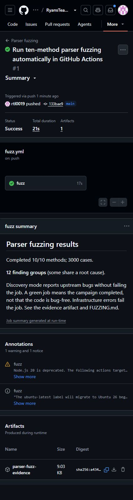

# Fuzzing ten Python methods

## Scope and approach

`fuzz.py` implements bounded, generative, property-based fuzzing using Python's
standard library and the parser's existing ruamel.yaml dependency. It combines
a small boundary corpus with new pseudorandom nested objects and mutated YAML
text. It does not just run the existing unit tests or repeat ten fixed inputs.

Boundary cases were selected after inspecting the source. They include empty
sequences, repeated keys in separate documents, scalar YAML keys, and nested
matching keys. Generated inputs vary nesting, keys, values, document counts,
path indices, and YAML text. Text mutations truncate documents, append malformed
syntax or additional documents, and prepend comments. Random object trees stop expanding at depth three and have at most three
children per node. Target adapters can add a wrapper mapping or a bounded list
of documents or paths. Inputs
are synthetic and contain no real credentials.

Each method runs in a separate subprocess with a 30-second wall-clock limit.
The complete CI job also has a six-minute limit. The fuzzer resets the parser's
global path mapping before each case, uses temporary YAML files, and does not
change production Python methods. No Kubernetes cluster, network requests,
scanner dependencies, or yq executable are needed for this campaign.

The properties are based on the helper docstrings and simple input contracts.
Reference traversals check keys, depths, values, and matches independently.
YAML syntax/round-trip checks use ruamel.yaml as a differential oracle for the
project's wrapper functions; this does not test the YAML library itself.
The Kubernetes check only tests required top-level fields and the project's
excluded-kind policy, not full Kubernetes schema compliance. Sequence-document
merging is checked using the supplied function's existing first-element policy.

## Ten selected methods

| Method in parser.py | Input families and checks |
| --- | --- |
| keyMiner | Nested objects; missing/present values; returned path must reach the requested value. |
| getKeyRecursively | Nested mappings/lists; every key occurrence and nesting depth must be preserved. |
| getValuesRecursively | Nested objects; all leaf values must be returned in traversal order. |
| getValsFromKey | Repeated/nested matching keys; return all matching values, including descendants of a match. |
| find_json_path_keys | YAML-derived objects including scalar keys; return string paths without mutating the input or crashing. |
| update_json_paths | Root/nested array indices and empty paths; remove only the leading document index. |
| getSingleDict4MultiDocs | Empty, scalar, sequence, and mapping documents; avoid crashes and preserve mapping entry counts. |
| loadMultiYAML | Valid/malformed/multidocument YAML; valid documents must round-trip without wrapper crashes. |
| checkParseError | Generated/mutated YAML syntax; agree with ruamel.yaml about syntax validity. |
| checkIfValidK8SYaml | YAML manifests; reject missing/empty top-level fields and avoid rejecting a Pod just because a label value says List. |

## Run and reproduce

From the project root, using the local Windows environment:

```powershell
.\.venv\Scripts\python.exe fuzz.py
```

For a fresh environment on another machine:

```text
python -m pip install -r requirements-fuzz.txt
python fuzz.py --seed 5710 --cases 300 --output fuzz-results
```

`--cases` is the number of cases per method, including that method's boundary
corpus. A fixed seed reproduces the input sequence on the same Python/dependency
versions. Different seeds change generated inputs. Example:

```text
python fuzz.py --seed 6710 --cases 300 --output fuzz-results/second-seed
python fuzz.py --replay evidence/fuzz-baseline/findings/08391fe626e5.json
python fuzz.py --fail-on-findings
```

The replay command above reproduces the empty-sequence crash and exits 1 while
that failure remains present. No source edits are needed to replay a finding.

`summary.json` records all ten methods, boundary/generated case counts, seed,
occurrence counts, representative inputs, expected/actual behavior, and exception
traces. Each failure group also has a separate JSON reproducer. A tagged mapping
format preserves null and numeric keys; plain JSON objects would turn these into
strings. Findings are grouped by method and property, or exception type and
source location. They are not a count of distinct root causes. The summary is
the authoritative index for a run; use a fresh output folder when retaining
multiple campaigns.

Exit codes:

- 0: discovery campaign completed. Findings may still be present and are reported.
- 1: findings found with `--fail-on-findings`, or a saved finding reproduced.
- 2: incomplete campaign, worker timeout, harness failure, or a replay that fails differently.

Default discovery mode is intentional because this assignment requires reporting
bugs in the supplied project. It does not silently discard failures. Timeouts
and infrastructure errors always fail the run. Use strict mode when findings
should block CI. A green discovery job means completed execution, not bug-free code.

## Local results, November 4, 2026

The baseline campaign used Python 3.12.14 and ruamel.yaml 0.17.21, seed 5710,
and 300 cases per method: **3,000 cases**, including **134 boundary cases and
2,866 generated/mutated cases**. All ten methods completed; there were no harness
errors. It produced **12 finding groups across six methods**, grouped into the
nine defect categories below. Four methods had no findings in this bounded run;
this is not proof of correctness.

A second campaign with seed 6710 completed another 3,000 cases. Repeating seed
5710 produced an identical summary. Every saved baseline finding was replayed
successfully. Strict-mode and timeout exit codes were checked. The original 23
parsing unit tests still pass, showing why the additional input exploration is
useful. See [baseline summary](evidence/fuzz-baseline/summary.json),
[second seed](evidence/fuzz-baseline/second-seed-summary.json),
[console output](evidence/fuzz-baseline/run.txt), and
[verification](evidence/fuzz-baseline/verification.txt).

## Confirmed defect categories

These findings remain unfixed so the saved evidence can be replayed against
the supplied behavior. Suggested corrections are separate from this fuzzing work.

| ID | Affected method(s) | Minimal input and observed behavior | Impact / suggested correction |
| --- | --- | --- | --- |
| F01 | getKeyRecursively | `{'a': []}` returns no keys; expected `('a', 0)`. | Empty/scalar-list keys disappear from downstream key checks. Record each mapping key before descending. |
| F02 | getKeyRecursively | `{'a': {}, 'b': 1}` gives b depth 1 instead of 0. | Siblings inherit depth changes from earlier children. Pass depth + 1 into recursion without modifying the parent's depth. |
| F03 | getValsFromKey | `{'target': {'target': 'needle'}}`, target `target`, omits the inner value. | Nested matches are lost because traversal stops below a match. Continue descending after recording it. |
| F04 | find_json_path_keys; loadMultiYAML; checkIfValidK8SYaml | Valid YAML `null: alpha` raises TypeError in the regex call. Float keys fail similarly. | Valid YAML can crash the loader/validator instead of being handled or rejected cleanly. Handle scalar key types explicitly. |
| F05 | getSingleDict4MultiDocs; checkIfValidK8SYaml | `[[]]` passed to the merge helper, or YAML `[]` passed to the validator, raises IndexError. | Empty sequences crash rather than yielding an empty result / false validation. Check sequence length before indexing. |
| F06 | getSingleDict4MultiDocs | `[{1: 'a'}, {1: 'b'}]` raises TypeError while constructing a suffixed key. | Repeated legal numeric YAML keys crash merging. Use a deliberate key-normalization or structured merge policy. |
| F07 | getSingleDict4MultiDocs | `[{'a': 1, 'a.YAML.DOC.1': 2}, {'a': 3}]` yields two entries instead of three. | A generated suffix overwrites an existing key. Check generated names for collisions. |
| F08 | checkIfValidK8SYaml | `apiVersion: ''` plus `kind: Pod` is accepted. Nested required fields can also be mistaken for root fields. | Invalid manifests are classified as valid. Validate nonempty required fields at the document root. |
| F09 | checkIfValidK8SYaml | A Pod with label `note: List` is rejected. | The excluded-kind filter searches every leaf value. Check the actual root kind field instead. |

Reproducer index:

- F01: [e16f3bb9e2d1](evidence/fuzz-baseline/findings/e16f3bb9e2d1.json)
- F02: [5b1203b61aef](evidence/fuzz-baseline/findings/5b1203b61aef.json)
- F03: [879dbc6423ec](evidence/fuzz-baseline/findings/879dbc6423ec.json)
- F04: [path traversal](evidence/fuzz-baseline/findings/4c3cb7c61977.json), [loader](evidence/fuzz-baseline/findings/2e00510aefe4.json), [validator](evidence/fuzz-baseline/findings/394be37c66f3.json)
- F05: [merge helper](evidence/fuzz-baseline/findings/08391fe626e5.json), [validator](evidence/fuzz-baseline/findings/6bd7c0543bc1.json)
- F06: [951e3d0669be](evidence/fuzz-baseline/findings/951e3d0669be.json)
- F07: [67d7b50e3d5c](evidence/fuzz-baseline/findings/67d7b50e3d5c.json)
- F08: [a1e136eea184](evidence/fuzz-baseline/findings/a1e136eea184.json)
- F09: [566944e285a1](evidence/fuzz-baseline/findings/566944e285a1.json)

## Automation

The published workflow at `.github/workflows/fuzz.yml` runs the existing parsing
tests and `fuzz.py` on pushes and pull requests to main, plus manual dispatch.
It installs only requirements-fuzz.txt, records an explicit discovery-mode
summary, and uploads JSON reproducers plus the console log as a 30-day artifact.
The latest execution and artifacts are available under the repository's Actions
tab. Forensic instrumentation and the final assignment report remain separate
work; the original scanner integration tests with external paths are not included.

Workflow references: [GitHub's Python workflow guide](https://docs.github.com/en/actions/tutorials/build-and-test-code/python)
and [artifact upload documentation](https://github.com/actions/upload-artifact).

## Limits

This is generative/property-based fuzzing, not coverage-guided Atheris fuzzing.
It does not measure line/branch coverage, fuzz the external yq executable, use
cyclic objects or unbounded nesting, or validate against a Kubernetes server.
The finite campaign does not guarantee that every defect is found. Findings
depend on the stated helper contracts; the report keeps shared root causes and
generated boundary inputs explicit. Final personal lessons learned belong in
the student's SQA-REPO.md after reviewing and understanding the results.

## Verified GitHub Actions execution

The first push-triggered run, [Parser fuzzing #1](https://github.com/rtl0019/RyansTeam-FALL2026-SQA/actions/runs/41898382445), completed successfully on November 4, 2026. Its summary records 10/10 methods, 3,000 cases, and 12 finding groups. The run also completed the existing parsing tests and published the parser-fuzz-evidence artifact. The workflow was added through GitHub's signed-in web editor because the local Git authentication lacks workflow upload scope; no account permission changes were needed.

