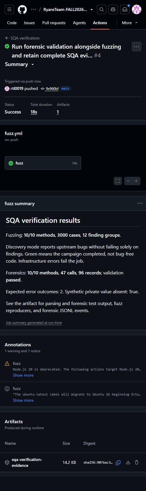
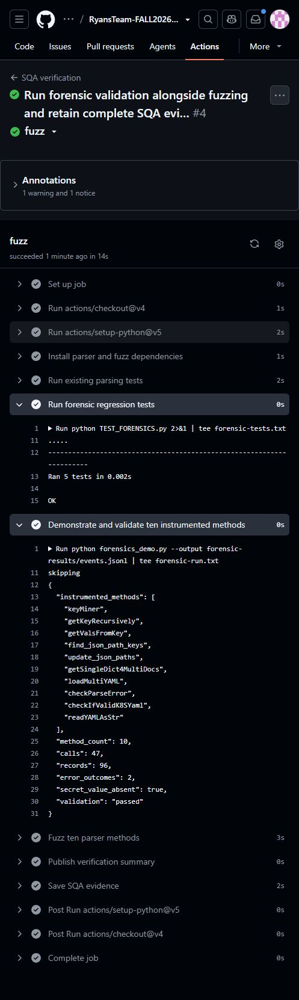

# Software Quality Assurance Project Report

**Course:** COMP 5710/6710, Fall 2026  
**Team:** Ryan's team  
**Member:** Ryan Lunsford, rtl0019@auburn.edu  
**Repository:** https://github.com/rtl0019/RyansTeam-FALL2026-SQA  
**Report date:** November 18, 2026

## 1. Project and setup

The project applies fuzzing, forensic instrumentation, and continuous integration to the supplied SLI-KUBE Python codebase, a static analyzer for Kubernetes YAML manifests. The original authors' documentation is preserved in [README-UPSTREAM.md](README-UPSTREAM.md).

The supplied archive was extracted to `D:\KubeSec-master`. A Python 3.12 environment and the required dependencies were configured. Missing imports and the Typer entry point in `main.py` were corrected so the scanner could run from PowerShell. The original file is preserved as `main.py.original`; [LOCAL-SETUP.md](LOCAL-SETUP.md) explains the environment and [run.ps1](run.ps1) provides the local launcher. A sample scan successfully produced CSV and SARIF output, including three reported findings. The 23 supplied parsing tests passed.

A public repository was created with the required team naming pattern and a README identifying the solo team member. Before initial publication, GitHub push protection detected a token in comments in two supplied YAML fixtures. Those occurrences were replaced with an explicit dummy value, and the parsing tests passed again. No real credential is needed for the tests or CI.

## 2. Fuzzing ten methods

[fuzz.py](fuzz.py) implements bounded generative/property-based fuzzing. It combines source-informed boundary cases with pseudorandom nested structures and mutated YAML. Each target runs in an isolated subprocess with a 30-second timeout. Fixed seeds, saved inputs, and independent properties make failures reproducible. The campaign clears the parser's global path mapping between cases and uses temporary files.

| Method | Property or input family |
| --- | --- |
| `keyMiner` | Returned paths resolve to the requested value. |
| `getKeyRecursively` | Every key occurrence and its nesting depth are preserved. |
| `getValuesRecursively` | All leaf values appear in traversal order. |
| `getValsFromKey` | All matching keys contribute their values, including nested matches. |
| `find_json_path_keys` | YAML key types do not crash traversal; paths are strings. |
| `update_json_paths` | Only the initial document index is removed. |
| `getSingleDict4MultiDocs` | Empty/scalar/mapping documents are handled; entries are preserved. |
| `loadMultiYAML` | Valid YAML round-trips without wrapper crashes. |
| `checkParseError` | Syntax validity agrees with the underlying YAML parser. |
| `checkIfValidK8SYaml` | Required root fields and the excluded-kind policy are checked correctly. |

Two baseline campaigns, seeds 5710 and 6710, each completed 300 cases per method: **6,000 total cases**. Seed 5710 included 134 boundary cases and 2,866 generated/mutated cases. Each campaign produced **12 finding groups**, representing **nine defect categories across six methods**. Repeating seed 5710 produced the same summary. All 12 baseline reproducers were replayed after instrumentation; their expected failures remained reproducible.

| ID | Observed defect |
| --- | --- |
| F01 | Keys with empty or scalar-list values disappear from recursive key collection. |
| F02 | A sibling inherits an incorrect nesting depth after an earlier child. |
| F03 | Searching for a matching key misses nested matches beneath that key. |
| F04 | Legal null/float YAML keys cause regex TypeError failures. |
| F05 | Empty sequence documents cause IndexError failures. |
| F06 | Duplicate numeric keys cause a TypeError when constructing a suffix. |
| F07 | Generated document suffixes collide with existing keys and overwrite entries. |
| F08 | Kubernetes validation accepts empty or incorrectly nested required fields. |
| F09 | A valid Pod is rejected when an unrelated label value matches an excluded kind. |

[FUZZING.md](FUZZING.md) gives exact inputs, impacts, suggested fixes and links to each reproducer. The [baseline summary](evidence/fuzz-baseline/summary.json), [second seed summary](evidence/fuzz-baseline/second-seed-summary.json), and [console log](evidence/fuzz-baseline/run.txt) preserve the results. The defects remain unfixed so the recorded failures can be demonstrated against the submitted behavior.

Discovery mode exits successfully when the campaign completes even if it discovers bugs. `--fail-on-findings` provides a strict gate. Timeouts and harness failures are errors in either mode. Therefore, a green CI job does not mean the original parser is bug-free.

## 3. Forensics in ten methods

Ten methods in [parser.py](parser.py) were explicitly modified with the `@forensic` decorator from [forensic_logging.py](forensic_logging.py). Nine are shared with the fuzz targets; `readYAMLAsStr` replaces the generator `getValuesRecursively` because generator suspension requires a different tracing model.

Instrumentation is opt-in through `forensic_session(path)`. JSONL records contain UTC timestamps, run IDs, sequence numbers, call IDs, parent-call relationships, argument type/length metadata, outcomes, and elapsed time. Exception records include exception types and bounded source-frame locations, while the original exceptions still propagate. Boolean return values distinguish successful validation from rejection. YAML contents, credentials, exception messages, local variables, and full paths are omitted.

[forensics_demo.py](forensics_demo.py) demonstrates all ten methods using synthetic inputs. It exercises successful traversal and parsing, malformed YAML returning `False`, the known empty-sequence merge failure, and a missing-file failure. Its validated output contains **47 calls and 96 records**, with two expected error outcomes. These expected errors demonstrate useful failure evidence; they are not unexpected demo failures.

The demo checks method coverage, sequence continuity, call/outcome pairing, parent references, nonnegative durations, expected exception classes, a rejection result, and absence of a synthetic private value. All five [forensic regression tests](TEST_FORENSICS.py) pass, checking disabled logging, signature/mutation preservation, exception propagation, overwrite protection, and context cleanup. The original 23 parsing tests also pass.

To investigate an error, locate its outcome record, match its call ID, and follow parent-call IDs to reconstruct the enclosing operations. The [validated event log](evidence/forensics/validated-events.jsonl), [summary](evidence/forensics/validated-events.summary.json), [regression verification](evidence/forensics/verification.json), and [FORENSICS.md](FORENSICS.md) provide evidence and interpretation.

## 4. Continuous integration

The workflow is [.github/workflows/fuzz.yml](.github/workflows/fuzz.yml). It triggers on pushes and pull requests to `main`, with manual dispatch also available. It installs the small parser dependency set from `requirements-fuzz.txt` on Python 3.12, runs the supplied parsing tests, and runs a 3,000-case fuzz campaign. The final integration additionally runs the five forensic regression tests and validates the forensic demonstration.

The job has a six-minute timeout and read-only repository permissions. Bash pipe failure handling preserves failing exit statuses when output is recorded with `tee`. A job summary explains the results and discovery-mode interpretation. Evidence is uploaded even when earlier steps fail, where files exist, and retained by GitHub for 30 days. Selected logs and screenshots are also committed so the report does not rely only on expiring artifacts.

[The combined verification run](https://github.com/rtl0019/RyansTeam-FALL2026-SQA/actions/runs/44388404621) succeeded on November 18, 2026, for commit `9e960bf88798632b071c4f5d1647c7bb1cc12c73`. It completed in 18 seconds and published `sqa-verification-evidence` (14.2 KB). The summary confirms 10/10 fuzz targets, 3,000 cases, 12 finding groups, and forensic validation of 10/10 methods, 47 calls and 96 records. The forensic test step reports five tests passing. Platform migration/deprecation annotations were nonfatal.





## 5. Reproduction

For a fresh Python 3.12 environment:

```text
python -m pip install -r requirements-fuzz.txt
python TEST_PARSING.py
python TEST_FORENSICS.py
python forensics_demo.py --output forensic-results/review/events.jsonl
python fuzz.py --seed 5710 --cases 300 --output fuzz-results/review
python fuzz.py --replay evidence/fuzz-baseline/findings/08391fe626e5.json
```

The last command intentionally exits 1 when the saved empty-sequence bug reproduces. Use a fresh forensic output path because the logger refuses to overwrite prior evidence. These QA commands require neither Kubernetes nor yq; running the full scanner requires the additional setup in LOCAL-SETUP.md.

## 6. Lessons learned from the results

- Passing conventional unit tests is useful but incomplete: 23 existing tests passed while fuzzing exposed nine defect categories involving unusual shapes, key types, and nested data.
- An oracle determines what a fuzz result means. Explicit properties distinguish a crash from a wrong result; shared root causes must not be counted as separate bugs merely because multiple wrappers fail.
- Reproducibility makes findings actionable. Fixed seeds and saved typed inputs allow an observed failure to be rerun instead of relying on a screenshot alone.
- Forensic evidence needs correlation. Timestamps alone do not explain nested calls; run IDs and parent-call links connect an exception to its execution path.
- Logging needs boundaries. Type/length metadata provides context without copying manifest values, and refusing to overwrite files helps preserve earlier evidence. This trades some reproduction detail for reduced exposure.
- CI status must be interpreted honestly. Discovery-mode success means the testing process completed; strict mode is needed when any finding should block a change.
- Portable setup matters. The original project contains machine-specific paths, while the QA workflow uses only the dependencies and synthetic inputs required for its tests.

## 7. Limitations and completion checks

This is bounded generative fuzzing, not coverage-guided fuzzing or proof of correctness. It does not validate full Kubernetes schemas, fuzz external yq, or execute every original scanner integration test with author-specific paths. The forensics implementation is synchronous execution logging, not signed/tamper-proof evidence acquisition. It does not record enough raw input data to reconstruct arbitrary manifests from logs alone. The assignment's short forensics wording was interpreted as execution reconstruction; any additional lecture-specific requirement should be checked with the instructor.

Code and evidence cover the fuzzing, forensic instrumentation, CI and report deliverables. Course spreadsheet registration and the final Canvas submission are separate student actions. Submit the public repository URL under **Semester Long Project** by **December 1, 2026, 11:59 PM CST**.
